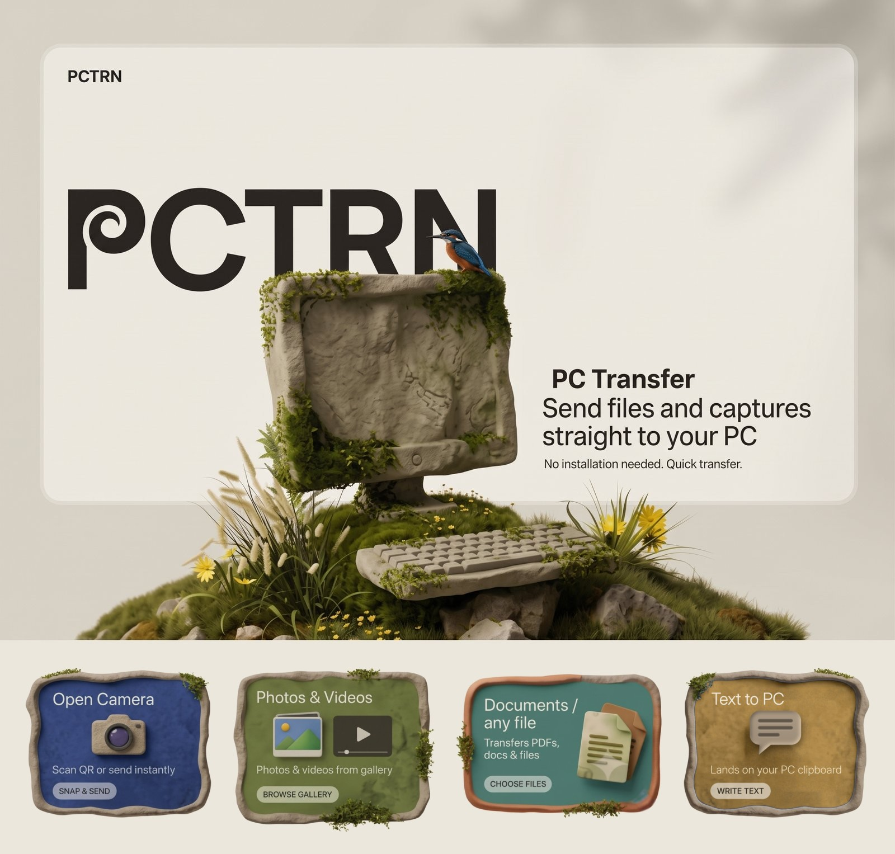
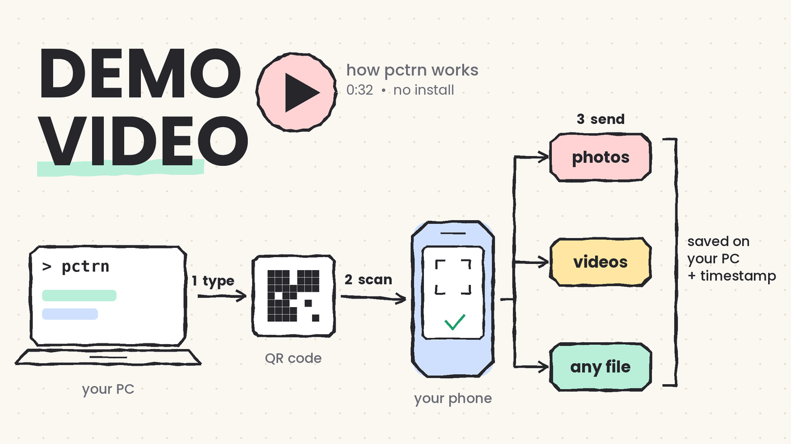

<div align="center">


# 𝙿𝙲𝚃𝚁𝙽

 

**Phone → PC in seconds. No app. No cloud. No WhatsApp Web.**

Scan a QR code, tap a button, and your photo, PDF or text lands in a folder on your PC.

   

</div>

---

## 😤 The problem

Getting one file from your phone to your laptop shouldn't feel like a side quest.

- **WhatsApp Web** takes ages to load, then ages to download.
- **Cable?** Never within reach, and the driver is never happy.
- **Sync apps** want you to install something on your phone.
- **Email yourself**, wait, open the inbox, download... for a *single photo*.

## 💡 The fix

PCTRN turns your laptop into a tiny private upload page. Your phone just opens it in the browser.

- 📷 **Live camera** that takes one photo or a whole stack of them (great for multi-page documents)
- 🖼️ **Gallery picker** for photos and videos
- 📁 **Any file** such as PDFs, docs and zips
- 📝 **Text to PC** that goes straight to your PC clipboard and also saves a `.txt`
- 🔗 **Links** (`https://…`, `http://…` or `www.…`) you send as text can be opened on the PC, but only after you confirm and enter a PIN at the PC
- 🔌 **Session-ended screen**: if PCTRN stops on the PC, your phone tells you instead of failing silently

Everything travels over your own Wi-Fi or hotspot and never touches the internet.

---

## ⚙️ How it works
Click the below image to check-out the demo video.
<div align="center">
<a href="https://github.com/user-attachments/assets/c05e90c6-284e-489c-b3da-61c6f6b85d2c">
  
</a>
</div>

---

1. You type `pctrn` in a terminal.
2. It finds your PC's current address, starts a small HTTPS server, and prints a **QR code**. A new address (hotspot, new Wi-Fi) is no problem, because the QR is regenerated every run.
3. You scan it. The page opens on your phone with nothing installed.
4. Whatever you send is saved in your folder with a timestamp in the name, so nothing is overwritten.
5. When you're done, press `Ctrl+C`, or let it close itself after the session timeout (20 minutes by default). Your phone shows **Session ended** within about 10 seconds.

> **Why HTTPS?** Phones only allow in-browser camera access on secure pages. PCTRN makes a self-signed certificate once, so your phone shows a "not secure" warning the first time. Tap **Advanced → Proceed**. The certificate is your own, is stored in `~/.pctrn/`, and never leaves your PC.

---

## 📥 Download

Pick one.

**Option A: Git**
```bash
git clone https://github.com/ankush-cloud3/PCTRN.git
cd PCTRN
```

**Option B: ZIP (no Git needed)**
1. On the repo page, click **Code → Download ZIP**.
2. Right-click the ZIP → **Extract All** into a **permanent** folder, for example `C:\Tools\pctrn`. The installer adds this folder to your PATH, so don't move it afterwards.
3. Open the folder and check that `pctrn.py` sits directly inside it, not inside a second nested folder.

---

## 🚀 Install

**Requirements:** Windows and Python 3.8 or newer.

### 1. Check Python
```bash
python --version
```
If this fails, install Python from [python.org](https://www.python.org/downloads/) and tick **"Add Python to PATH"** in the installer.

### 2. Create your settings file
```bash
copy .env.example .env
```
Open .env and edit as needed. Every setting is optional, but set PCTRN_SAVE_DIR to your preferred folder path. 

### 3. Run the installer
Double-click `install.bat` (or run it from a terminal in the project folder). It:
- installs the libraries from `requirements.txt` (flask, cryptography, qrcode, python-dotenv)
- adds the project folder to your user PATH so `pctrn` works from anywhere

Wait for **Done**, then **close that window**.

### 4. Start it from a NEW terminal
PATH changes only apply to terminals opened after the install.

```bash
pctrn          # start
pctrn --pin    # start with a random 4-digit PIN the phone must enter
```

### 5. Connect your phone
1. Put the phone on the **same Wi-Fi** as the PC (or connect the PC to the phone's hotspot).
2. Scan the QR code in the terminal, or type the printed `https://…` address.
3. Accept the one-time certificate warning (**Advanced → Proceed**).
4. If Windows Firewall asks about Python, allow it on **Private networks**.


---

## ⚙️ Settings (`.env`)

All settings are optional. Copy `.env.example` to `.env` to change them.

| Setting | Default | What it does |
|---|---|---|
| `PCTRN_SAVE_DIR` | `~/pctrn_received` | **Set this to the folder you want.** Everything from your phone is saved there. Created automatically if missing. |
| `PCTRN_PORT` | `5000` | Port the server uses. |
| `PCTRN_LINK_PIN` | *(empty)* | Your own PIN, typed **on the PC** to open a link sent from your phone in texts. Empty = links are never opened. |
| `PCTRN_SESSION_MINUTES` | `20` | Auto-shutdown timer. `0` means run until `Ctrl+C`. |

Example `.env`:
```env
PCTRN_SAVE_DIR=D:\Transfers
PCTRN_PORT=5000
PCTRN_LINK_PIN=
PCTRN_SESSION_MINUTES=20
```

---

## ✅ Why you'll like it

- **Nothing to install on the phone**, because it's just a web page.
- **Fast**, since transfers stay on your local network with no cloud round-trip.
- **Private**, as nothing goes through a server you don't own.
- **Works on any network**, because the QR is fresh each run (home Wi-Fi, phone hotspot, hotel).
- **Optional PIN** for shared networks, with a lockout after 5 wrong tries.
- **Multi-shot camera** to take several photos, then **Send all** in one go.
- **Clear status**: the phone shows a live connection indicator and a **Session ended** screen when the PC stops.
- **Self-cleaning** and **self-closing**, so you don't leave a server running by accident.

---

## 🛡️ Good to know

- Phone and PC must be on the **same network**. If a hotel or office Wi-Fi blocks device-to-device traffic, use your phone's hotspot.
- Use it on networks you trust, and use `pctrn --pin` on shared ones.
- **Auto-cleanup:** each time PCTRN starts, it deletes files it saved earlier (names starting with a timestamp) that are **older than 1 hour**. Move anything you want to keep out of the save folder.
- **Auto-stop:** PCTRN shuts itself down after `PCTRN_SESSION_MINUTES` (20 by default).
- **Session ended:** the phone checks in with the PC every few seconds. After about 10 seconds without an answer it shows the *Session ended* screen. Start PCTRN again and scan the new QR code.
- **Links:** only `http://`, `https://` and `www.` links are detected. Bare domains like `example.com` are ignored on purpose.

---

## 🧰 Troubleshooting

| Problem | Fix |
|---|---|
| `pctrn` is not recognized | Open a **new** terminal after `install.bat`. Still failing? Run `python pctrn.py` from inside the project folder. |
| *"Port 5000 is already in use"* | An older PCTRN window is still open. Close it (or press `Ctrl+C` there), or set a different `PCTRN_PORT`. |
| Phone can't open the page | Same Wi-Fi? Allow Python through Windows Firewall on Private networks. Try the phone hotspot if the network isolates devices. |
| Camera button does nothing | Open the page via the `https://` address and accept the certificate warning. |
| Phone shows *Session ended* | PCTRN was stopped or timed out. Run it again and rescan. |
| Link in my text didn't open | Set `PCTRN_LINK_PIN` in `.env`, restart, then confirm `y` and enter the PIN in the PC terminal within 30 seconds. |

---

## 🗑️ Uninstall

1. Close PCTRN if it's running (`Ctrl+C`).
2. Delete the project folder.
3. Delete the certificate folder `~/.pctrn/` (on Windows: `C:\Users\<you>\.pctrn`).
4. Remove the project folder from your user PATH: *Start → "Edit environment variables for your account" → Path → select the entry → Delete.*

---   

## 📁 What's in the box

```
pctrn/
├── pctrn.py            # the server and the upload page
├── pctrn.bat           # makes the "pctrn" command work
├── install.bat         # one-time Windows setup
├── requirements.txt    # Python dependencies
├── .env.example        # copy to .env and edit
├── .gitignore
├── LICENSE
└── assets/             # README image
```

---

## 📄 License

MIT. See [LICENSE](LICENSE).

---

<div align="center">

Made so that sending one photo to your PC takes **one scan** and not ten steps. ⚡

</div>
